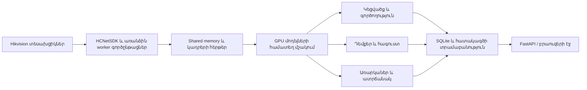

# Detect․ նախագիծը և այլ համակարգչում տեղադրման մանրամասն ուղեցույց

Պահոց՝ **https://github.com/gevorgsc/detect-deploy**  
Մոդելներ և SDK՝ **https://github.com/gevorgsc/detect-deploy/releases/tag/migration-v1**  
Պատրաստման ամսաթիվ՝ **2026-10-21**։

## 1. Ինչ նախագիծ է

Detect-ը Hikvision տեսախցիկների տեսանյութը տեղային համակարգչում մշակող ծրագիր է։
Այն միավորում է մարդկանց ու առարկաների հայտնաբերումը, կեցվածքի և գործողության
գնահատումը, դեմքերի ճանաչումը, ատրճանակի հայտնաբերումը և հատակագծի վրա մարդկանց
տեղաշարժի ցուցադրումը։ Օպերատորը ծրագրից օգտվում է բրաուզերով։

Գործարկումից հետո էջը բացվում է **http://localhost:8000** հասցեով։ Տեսանյութի մշակումն
ու տվյալների պահպանումը կատարվում են այն համակարգչում, որտեղ աշխատում է ծրագիրը։
Տեղադրման ժամանակ մոդելներն ու կախվածությունները ներբեռնվում են ինտերնետից։

Հիմնական հնարավորություններն են՝

- Մի քանի Hikvision տեսախցիկների միաժամանակյա տեսահոսք։
- Մարդու կմախք և կեցվածք՝ օրինակ նստած կամ կանգնած։
- Հեռախոսի և աշխատանքային առարկաների հետ փոխազդեցության հիման վրա ակտիվության գնահատում։
- Դեմքի ճանաչում, մարդու քարտ և տեղում ստեղծվող նույնականացումներ։
- Օրվա ժամանակագիծ, ներկայության, աշխատանքի և պարապուրդի հատվածներ։
- Ատրճանակի հայտնաբերում հատուկ ուսուցված մոդելով։
- Հագուստի գույնի հատկանիշներ և դրանցով որոնում։
- Մասնաճյուղեր, հատակագիծ, գոտիներ, կալիբրացիա և շարժման ուղիներ։

Սրանք գործառույթների նկարագրություններն են։ Այլ GPU-ի արագությունը, իրական
տեսախցիկների պատկերների որակը և ճանաչման ճշտությունը պետք է ստուգել տեղում։
Բոլոր քարտերի ու տեսարանների համար նույն արդյունավետությունը չափված չէ։

## 2. Ինչպես է աշխատում



Յուրաքանչյուր տեսախցիկի SDK-ն աշխատում է առանձին գործընթացում։ Ծանր GPU մոդելները
բեռնվում և օգտագործվում են հիմնական գործընթացում։ Այս բաժանումը մեկուսացնում է
տեսախցիկի SDK-ն GPU մշակման մասից։ Վեբ ինտերֆեյսի հիմնական HTML/CSS/JavaScript-ը
ներկառուցված է `web/web_server.py`-ում․ առանձին Node.js frontend build պետք չէ։

## 3. Ֆայլերը և դրանց դերը

| Ֆայլ կամ պանակ | Նպատակ |
|---|---|
| `web/web_server.py` | Գլխավոր ծրագիր, GPU մշակում, API և վեբ ինտերֆեյս |
| `camera/camera_worker.py` | Տեսախցիկի առանձին գործընթաց |
| `camera/camera_sdk.py` | Hikvision SDK-ի Python կապակցում |
| `camera/SDK/lib/` | SDK-ի DLL-ներ․ տեղադրվում են release-ից |
| `camera/config/cameras.example.json` | Հանրային օրինակ՝ առանց իրական մուտքային տվյալների |
| `camera/config/cameras.json` | Տեղային իրական կարգավորումներ․ Git-ում չի պահվում |
| `recognition/` | Հայտնաբերման, ակտիվության և գծագրման կոդ |
| `web/face_store.py` | Դեմքերի քարտերի և նույնականացման տվյալների պահպանում |
| `web/analytics_store.py` | Վերլուծություն և ժամանակային հատվածների պահպանում |
| `web/floor_map.py` | Հատակագիծ, կալիբրացիա, գոտիներ և երթուղիներ |
| `web/person_memory.py` | Ընթացիկ մարդկանց/հետագծերի հիշողություն |
| `install.ps1` | Python միջավայրի, մոդելների ու կախվածությունների տեղադրում |
| `start.ps1` / `stop.ps1` | Գործարկում և կանոնավոր անջատում |
| `scripts/configure_cameras.py` | Իրական տեսախցիկների տվյալների տեղային մուտքագրում |
| `scripts/fetch_assets.py` | Ներբեռնում, SHA-256 ստուգում և փաթեթների տեղադրում |
| `scripts/doctor.py` | Ֆայլերի, SDK-ի, GPU-ի և մոդելների ստուգում |
| `scripts/build_engines.py` | Նոր GPU-ի համար TensorRT շարժիչների կառուցում |
| `requirements.txt` / `requirements.lock` | Կախվածություններ և ընտրված տարբերակներ |
| `assets-manifest.json` | Փաթեթների անդամները, չափերը, հասցեներն ու SHA-256-ները |
| `source-environment.json` | Սկզբնական աշխատող համակարգի միջավայրը |
| `INSTALL_HANDOFF.md` | Այլ համակարգչում աշխատանքը շարունակող Codex-ի ուղեցույց |

## 4. Մոդելներն ու release փաթեթները

Կոդը գտնվում է repo-ում, մեծ մոդելներն ու SDK-ն՝ **Releases** բաժնում։ Git clone-ը
կամ Code → Download ZIP-ը միայնակ չեն բերում մոդելները․ տեղադրիչը բեռնում է դրանք։
Git LFS պետք չէ։

| Փաթեթ | Պարունակություն | Սկզբում պարտադիր է |
|---|---|---|
| `detect-core-v1.zip` | Երեք հիմնական `.pt`, AntelopeV2, Hikvision SDK, InsightFace wheel | Այո |
| `detect-config-public-v1.zip` | Օրինակային կապեր, մոդելների միացումներ, մասնաճյուղ, հատակագիծ և կալիբրացիա | Այո |
| `detect-source-engines-v1.zip` | Սկզբնական GPU-ի TensorRT արտահանումները՝ տեղեկանքի համար | Ոչ |
| `detect-optional-1-v1.zip` | Այլընտրանքային/պահեստային մոդելների առաջին խումբ | Ոչ |
| `detect-optional-2-v1.zip` | Այլընտրանքային մոդելների և արտահանումների երկրորդ խումբ | Ոչ |

Հիմնական գործարկման մոդելները՝

- **yolo11s-pose.pt**՝ մարդու կմախք և կետեր։
- **yolo26x.pt**՝ առարկաների հայտնաբերում։
- **weapon.pt**՝ հատուկ ուսուցված ատրճանակի դետեկտոր։
- **AntelopeV2 / InsightFace**՝ դեմքի հայտնաբերման և ճանաչման ընդհանուր ցանցեր։

Բոլոր release փաթեթները միասին մոտ 2.7 GiB են։ Սկզբում բեռնվում են միայն հիմնական
մոտ 530 MiB փաթեթն ու փոքր կարգավորումների փաթեթը։ Python-ի ու CUDA-ի կախվածությունները
ներբեռնվում են առանձին և լրացուցիչ սկավառակային տեղ օգտագործում։

## 5. Ինչ տվյալներ չեն տեղափոխվում

Չկան գրանցված մարդկանց բազաները, դեմքերի նկարները, անձնական նույնականացման
վեկտորները, անհայտ դեմքերի կադրերը, պատմությունը, SQLite բազաները և գրանցամատյանները։
Առաջին գործարկման ժամանակ ստեղծվում են նոր դատարկ բազաներ։ Հետո նոր տեսախցիկների
կադրերից ծրագիրը կարող է բնականոն ձևով նոր քարտեր ու գրառումներ ստեղծել։

AntelopeV2-ի ընդհանուր մոդելի քաշերը առկա են։ Դրանք նախկին տեղադրման գրանցված
մարդկանց տվյալները չեն։

Իրական տեսախցիկների գաղտնաբառերը բացակայում են հանրային փաթեթում։ IP-ները օրինակային
`192.0.2.x` հասցեներ են, մուտքանուններն ու գաղտնաբառերը՝ դատարկ։ Դրանք լրացվում են
նպատակային համակարգչում։ Սկզբնական համակարգչի իրական կարգավորումները չեն փոփոխվել։

## 6. Նոր համակարգչի պահանջները

- **64-bit Windows**․ ներառված տեսախցիկի SDK-ն Windows DLL-ներով է։
- **Python 3.11 x64**։
- **NVIDIA GPU և համատեղելի վարորդ**․ հիմնական գործարկումը CUDA է օգտագործում։
- Տեսախցիկների IP-ներին ցանցային հասանելիություն և ճիշտ SDK մուտքային տվյալներ։
- Ինտերնետ՝ մոդելների ու Python-ի կախվածությունների սկզբնական ներբեռնման համար։
- Բավարար սկավառակային տեղ ZIP-երի, բացված մոդելների, `.venv`-ի ու հետագա տվյալների համար։

Սկզբնական միջավայրը՝ **RTX 5080 / 16 GB VRAM**, **Python 3.11.9**,
**PyTorch 2.11.0 + CUDA 12.8**։ Այլ քարտի նվազագույն հիշողությունն ու արագությունը
այս տեղափոխման ընթացքում չեն չափվել։ Միայն Intel/AMD GPU-ով կամ CPU-ով ընթացիկ
լռելյայն կարգավորումը գործարկելու համար առանձին կոդային հարմարեցում է պետք։

Python՝ https://www.python.org/downloads/windows/ ։ Git-ը պարտադիր չէ։ Node.js,
Docker և Git LFS հիմնական տեղադրման համար չեն պահանջվում։

## 7. Կոդը ստանալը

**Առանց Git-ի․** բացել repo-ն, ընտրել **Code → Download ZIP**, բացել ZIP-ը մշտական
պանակում, օրինակ `C:\Detect`, և PowerShell-ը բացել այդ պանակում։ Այնտեղ պետք է երևան
`install.ps1`, `start.ps1`, `web`, `camera`, `recognition` ֆայլերն ու պանակները։
Ծրագիրը մի գործարկեք ZIP-ի ներսից։

**Git-ով․**

```powershell
git clone https://github.com/gevorgsc/detect-deploy.git C:\Detect
Set-Location C:\Detect
```

Repo-ն public է։ Ներբեռնման համար GitHub հաշվի մուտք կամ GitHub CLI պետք չէ։

## 8. Python-ի և GPU-ի նախնական ստուգում

```powershell
py -3.11 --version
nvidia-smi
```

Առաջին հրամանը պետք է ցույց տա Python 3.11։ Եթե `py`-ը չկա, ստուգել `python --version`․
տեղադրիչը կարող է օգտագործել այն, եթե դա Python 3.11 x64 է։ Եթե ոչ մեկը չի գտնվում,
տեղադրել Python-ը և նորից բացել PowerShell-ը։

`nvidia-smi`-ով պետք է երևա քարտն ու վարորդը։ Վարորդը պետք է համատեղելի լինի CUDA
տարբերակի հետ։ PyTorch-ի փաթեթը տեղադրում է իր CUDA runtime կախվածությունները․
սովորական տեղադրման ընթացքի մեջ առանձին CUDA Toolkit-ի տեղադրման քայլ չկա։

## 9. Ավտոմատ տեղադրում

Repo-ի պանակում՝

```powershell
powershell -NoProfile -ExecutionPolicy Bypass -File .\install.ps1
```

Տեղադրիչը ստուգում է Windows/Python-ը, ստեղծում է առանձին `.venv`, բեռնում է `core`
և `config` փաթեթները, ստուգում ZIP-երի ու անդամների SHA-256-ները, բացում է մոդելներն
ու SDK-ն, տեղադրում է CUDA PyTorch-ը և կախվածությունները, ապա փորձարկում է հիմնական
մոդելները դատարկ կադրով։ Այս փուլը տեսախցիկների մուտք չի կատարում։

Տեղադրման նպատակային հասցեները՝

- Երեք հիմնական `.pt` ֆայլերը՝ `recognition/`։
- Hikvision SDK-ն՝ `camera/SDK/lib/`։
- AntelopeV2՝ `%USERPROFILE%\.insightface\models\antelopev2\`։
- Ներբեռնված ZIP-երը՝ `.downloads/`։
- Տեղային կարգավորումները՝ `camera/config/cameras.json`։

Կրկնակի տեղադրումը պահպանում է գոյություն ունեցող `cameras.json`-ը և ձեր լրացրած
կապերը չի փոխարինում օրինակային տվյալներով։

## 10. Տեսախցիկների տեղային կարգավորում

```powershell
.\.venv\Scripts\python.exe scripts\configure_cameras.py
```

Գործիքը յուրաքանչյուր տեսախցիկի համար հարցնում է իրական IPv4-ը, մուտքանունը,
թաքնված գաղտնաբառը, SDK պորտը և ալիքը։ Պորտի օրինակը `8000` է, ալիքինը՝ `1`։
Դատարկ Enter-ը պահպանում է հին արժեքը։ Առաջին անգամ օրինակային IP-ներն ու դատարկ
մուտքային տվյալները պետք է լրացնել։ Գործիքը տեսախցիկներին չի միանում։

Կարելի է նաև UTF-8 տեքստային խմբագրիչով փոխել `camera/config/cameras.json`-ը։
Մեկ camera օբյեկտի պարզեցված կառուցվածք՝

```json
{
  "id": "cam_01",
  "name": "Camera 1",
  "ip": "192.0.2.11",
  "port": 8000,
  "username": "",
  "password": "",
  "channel": 1,
  "models": {
    "pose": true,
    "objects": true,
    "weapon": true,
    "face": true,
    "clothes": true
  }
}
```

Իրական ֆայլում պահպանեք առկա `branch`, `floor_calib` և մյուս կապակցված դաշտերը։
Տեսախցիկի `id`-ն մի փոխեք, եթե պահպանում եք նրա հատակագծի կապը։ Եթե փոխվել է
տեսախցիկի դիրքը կամ տեսարանը, պետք է նորից կալիբրացնել։

Եթե իրական տեղադրումը չորսից քիչ տեսախցիկ ունի, ավելորդ օբյեկտները հեռացնել տեղային
JSON-ի `cameras` ցուցակից՝ պահպանելով վավեր JSON-ը։ Հիմնական `.pt` մեկնարկը կապված չէ
նախկին engine-ի batch-ի հետ։ Նոր engine կառուցելիս օգտագործվում է նոր քանակը։

Առանց կապվելու ստուգել կարգավորումները՝

```powershell
.\.venv\Scripts\python.exe scripts\configure_cameras.py --check
```

`start.ps1`-ը նույնպես ստուգում է դրանք և օրինակային IP-ներով կամ դատարկ մուտքային
տվյալներով չի սկսում տեսախցիկների միացումը։

## 11. Գործարկում և առաջին իրական ստուգումները

Նախորդ համակարգչի նույն ծրագիրը կանոնավոր փակել, ապա նոր համակարգչում՝

```powershell
powershell -NoProfile -ExecutionPolicy Bypass -File .\start.ps1
```

Սկզբում բեռնվում են մոդելները, հետո տեսախցիկները միանում են հերթով։ Մինչ ավարտը էջը
կարող է չպատասխանել։ Այնուհետև բացել **http://localhost:8000**։

Ստուգել՝ էջը բացվում է, բոլոր տեսախցիկներից թարմ պատկեր կա, կմախքներն ու առարկաները
գծագրվում են, նոր կադրերից դեմքերի նոր գրառումներ են ստեղծվում, ակտիվության
ժամանակագիծը տվյալներ է հավաքում, հատակագծի կետերը ճիշտ տեղում են, և երկար մշակման
ընթացքում GPU հիշողությունը չի սպառվում։

GPU-ի դիտարկումը առանձին պատուհանում՝

```powershell
nvidia-smi -l 2
```

Այդ դիտարկումը կանգնեցնել Ctrl+C-ով․ մյուս պատուհանի ծրագիրը շարունակում է աշխատել։

## 12. Կանոնավոր անջատում

Հիմնական պատուհանում Ctrl+C կամ առանձին PowerShell-ում՝

```powershell
powershell -NoProfile -ExecutionPolicy Bypass -File .\stop.ps1
```

Սա դիմում է `POST http://localhost:8000/api/shutdown` հասցեին։ SDK-ն պետք է հասցնի փակել
սեսիաները։ Սովորական անջատման համար Task Manager-ի force-kill մի օգտագործեք։

## 13. TensorRT՝ կառուցում նոր GPU-ի վրա

Սկզբում ստուգել սովորական `.pt` գործարկումը։ Հետո ծրագիրը անջատել և, եթե պետք է,
կառուցել նոր շարժիչներ նպատակային GPU-ի վրա՝

```powershell
powershell -NoProfile -ExecutionPolicy Bypass -File .\install.ps1 -BuildEngines
```

Տեղադրվում են TensorRT-ի լրացուցիչ կախվածությունները, կառուցվում և փորձարկվում են
շարժիչները, իսկ հաջող ֆայլերը դրվում են `recognition/`-ում։ Գործարկման ժամանակ
ծրագիրը նույնանուն `.engine`-ը նախընտրում է `.pt`-ից։

| Մոդել | Մուտքի բարձրություն × լայնություն | Առավելագույն batch |
|---|---|---|
| Pose | `736 × 1280` | `4` |
| Objects | `1088 × 1920` | `1` |
| Weapon | `1088 × 1920` | Առնվազն `2`, կամ տեսախցիկների քանակը |

Սկզբնական GPU-ի engine-ները նոր GPU-ի/TensorRT-ի հետ կարող են չաշխատել։ Այդ պատճառով
դրանք ներբեռնվում են միայն `reference_engines/` և ինքնուրույն չեն ակտիվանում։ Այնտեղից
`recognition/` պատճենելը տեղադրման քայլ չէ։

Եթե VRAM-ը չի բավարարում, միասին հարմարեցնել `web/web_server.py`-ի գործարկման չափերն
ու batch-երը և `scripts/build_engines.py`-ի արտահանման պարամետրերը։ Engine-ները փոխել
միայն անջատված ծրագրի ժամանակ։

## 14. Պահեստային մոդելների ներբեռնում

```powershell
.\.venv\Scripts\python.exe scripts\fetch_assets.py --groups engines optional
```

Այստեղ կան նաև YOLOE/YOLO-World, MobileCLIP, CLIP, PAR և ONNX արտահանումներ։ Դրանք
պարտադիր չեն լռելյայն գործարկման համար։ Ներբեռնումը չի ակտիվացնում բոլոր տարբերակները։
Լռելյայն ատրճանակի դետեկտորը `weapon.pt`-ն է։

## 15. Ձեռքով ներբեռնում, եթե ավտոմատը չի ստացվում

Releases-ի `migration-v1` էջից բեռնել `detect-core-v1.zip` և `detect-config-public-v1.zip`,
repo-ի արմատում ստեղծել `.downloads` պանակը և ZIP-երը նույն անուններով դնել այնտեղ։
Դրանք ձեռքով բացել պետք չէ։ Նորից գործարկել `install.ps1`․ այն կստուգի և կօգտագործի
առկա ZIP-երը։ Python-ի կախվածությունները դեռ ինտերնետից են տեղադրվում․ ամբողջական
offline wheelhouse այս repo-ում չի պատրաստվել։

## 16. Տարածված խնդիրներ

| Ախտանիշ | Ինչ ստուգել |
|---|---|
| Python չի գտնվում | Python 3.11 x64, `py` կամ `python`, նոր PowerShell պատուհան |
| `CUDA is unavailable` | NVIDIA վարորդ, `nvidia-smi`, `.venv`-ի Python և CUDA PyTorch |
| GPU out of memory | VRAM, այլ GPU ծրագրեր, պատկերի չափեր և batch-եր |
| DLL load error | SDK-ի ամբողջ պանակը և Microsoft Visual C++ 2015–2022 Redistributable x64 |
| SHA-256 mismatch | Թերի/հին ZIP․ հեռացնել միայն նշված ZIP-ը `.downloads`-ից և նորից բեռնել |
| Օրինակային IP / դատարկ credentials | `configure_cameras.py`, հետո `--check` |
| Camera connection failed | IP հասանելիություն, SDK պորտ, ալիք, մուտքանուն և գաղտնաբառ |
| Camera account locked | Դադարեցնել կրկնվող մուտքերը, ուղղել տվյալները, սպասել սարքի արգելափակման ավարտին |
| Էջը դեռ չի բացվում | Սպասել մեկնարկին և կարդալ հիմնական պատուհանի իրական սխալը |
| Պորտ 8000-ն զբաղված է | Ստուգել արդեն աշխատող օրինակը․ կրկնակի մի գործարկել |
| Engine load error | Կառուցել նոր engine կամ անջատված ծրագրի ժամանակ հանել անհամատեղելի engine-ը ակտիվ պանակից |
| Դեմքերի մոդելը CPU-ի վրա է | ONNX Runtime CUDA provider և `doctor.py --models` |
| Հատակագծի կետերը սխալ են | Տեսախցիկի դիրք և կալիբրացիա |

Ընդհանուր ստուգում՝ առանց տեսախցիկների մուտքի՝

```powershell
.\.venv\Scripts\python.exe scripts\doctor.py --models
```

InsightFace-ը տեղադրվում է `--no-deps`, որովհետև metadata-ում պահանջում է CPU
`onnxruntime` անունով փաթեթ, իսկ ծրագիրն օգտագործում է `onnxruntime-gpu`։ `pip check`-ը
կարող է դրա անվան մասին բողոքել նույնիսկ աշխատող GPU միջավայրում։ CPU տարբերակով մի
փոխարինեք GPU runtime-ը․ ստուգեք իրական CUDA սեսիաները `doctor.py`-ով։

## 17. Տեղային տվյալներ և հետագա թարմացումներ

Առաջին մեկնարկից հետո `data/`-ում ստեղծվում են վերլուծության ու դեմքերի բազաները և
նկարների պանակները։ `data/`, `camera/config/cameras.json`, քեշը, միջավայրը և ծանր
մոդելները Git-ի ignore-ում են։

Հետագա թարմացումից առաջ կանոնավոր անջատել ծրագիրը և տեղային տվյալների պատճեն պահել։
Աշխատող SQLite-ը պարզապես պատճենելը կարող է բաց թողնել WAL-ում մնացած փոփոխությունները․
պատճեն վերցնել անջատված ծրագրից կամ SQLite backup API-ով։

Repo-ի նոր օրինակը նախկին մարդկանց չի վերականգնում։ Փաթեթը հատուկ պատրաստվել է
առանց նախկին մարդկանց և պատմության տեղափոխման։

## 18. Ինչ ուղարկել Codex-ին նոր համակարգչում

> Տեղադրիր https://github.com/gevorgsc/detect-deploy նախագիծը այս համակարգչում։
> Կարդա PROJECT_AND_INSTALLATION_HY.md և INSTALL_HANDOFF.md։ Ստուգիր GPU-ն ու Python-ը,
> տեղադրիր կախվածություններն ու մոդելները, օգնիր տեղում լրացնել տեսախցիկները և
> ստուգիր իրական գործարկումը։ Նախկին մարդկանց տվյալները տեղափոխել պետք չէ։

Եթե կոդն արդեն բեռնված է, Codex-ում բացել դրա պանակը։ Գաղտնաբառերը լրացնել տեղային
գործիքով, որպեսզի դրանք չհայտնվեն հանրային repo-ում։

## 19. Ստուգվածը և նոր համակարգչում մնացող աշխատանքը

Ստուգվել են Python/PowerShell կոդի վերլուծումը, կախվածությունների տարբերակների լուծումը,
ZIP-երի ու անդամների SHA-256-ները, առանձին պանակում բացումը, տեղային կարգավորման
պահպանումը կրկնակի տեղադրման ժամանակ, դատարկ բազաներով ծրագրի import-ը և էջի HTTP
պատասխանը։ Հանրային տարբերակի համար ստուգվում են նաև առանց GitHub մուտքի ներբեռնումը
և օրինակային camera կարգավորումների մերժումը։

Նոր համակարգչի GPU/վարորդը, իրական տեսահոսքը, միաժամանակյա հիշողության օգտագործումը,
տեսախցիկների մուտքը և կոնկրետ տեսարանի ճանաչման որակը պետք է ստուգել հենց այնտեղ։

